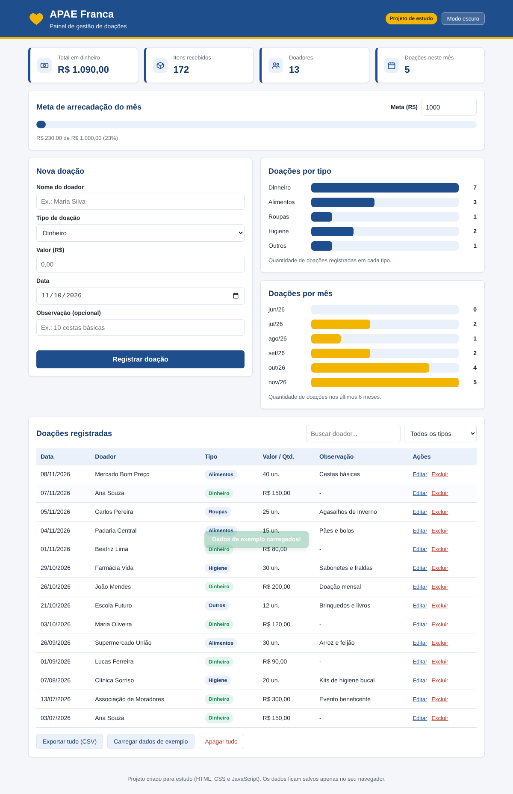

# Dashboard de Doações - APAE Franca

Projeto de estudo para praticar HTML, CSS e JavaScript. Escolhi a APAE de Franca por ser uma instituição com uma causa muito boa e por ter percebido que ela poderia se beneficiar de um sistema para organizar as doações.

> Este projeto não é um sistema oficial da APAE. Foi feito apenas para fins de estudo.

## Como foi feito

Utilizei inteligência artificial como ferramenta de apoio durante o desenvolvimento, tanto na construção do código quanto na explicação do seu funcionamento, com o objetivo de aprender ao longo do processo.

## O que ele faz

- Cadastra doações de dinheiro, alimentos, roupas, higiene e outros
- Permite editar e excluir uma doação
- Mostra o total em dinheiro, os itens recebidos, o número de doadores e as doações do mês
- Tem uma meta de arrecadação mensal, com barra de progresso
- Exibe gráficos de doações por tipo e por mês
- Possui busca por doador e filtro por tipo
- Exporta os dados para uma planilha (CSV)
- Tem modo claro e modo escuro
- Funciona no computador e no celular

## Tecnologias

HTML, CSS e JavaScript puro, sem bibliotecas.

## Como abrir

1. Baixe os arquivos do projeto
2. Abra o `index.html` no navegador
3. Para ver o painel preenchido, clique em **Carregar dados de exemplo** (os nomes e valores são inventados)

Os dados ficam salvos apenas no navegador de quem está usando. Nada é enviado para a internet.

## O que foi mais difícil

Identificar o que a instituição realmente precisa. É possível colocar muitas funções em um sistema, mas o mais importante é manter somente o que ajuda no dia a dia: cadastrar, acompanhar e organizar as doações.
